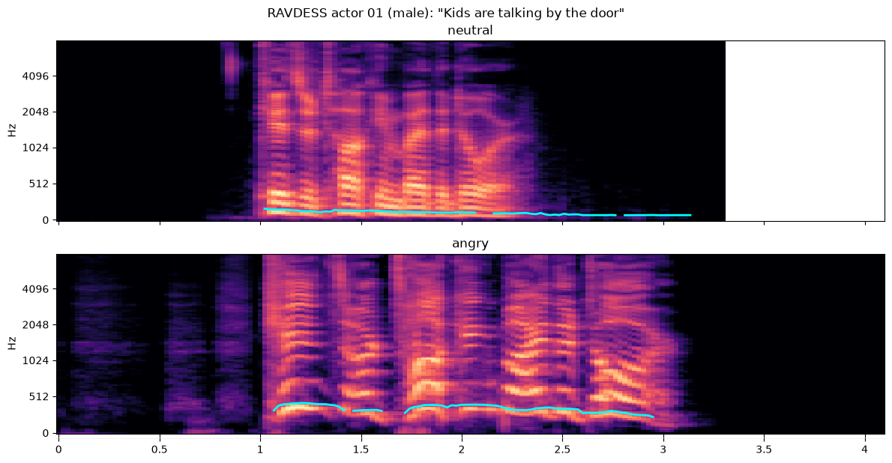
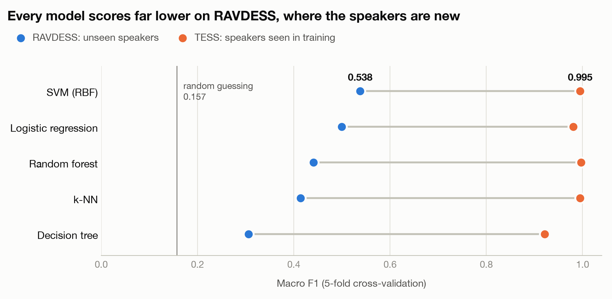
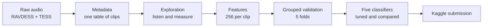
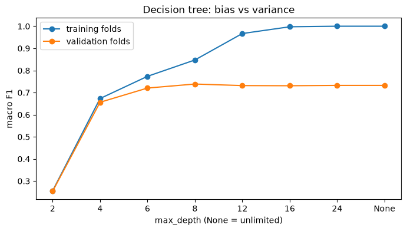
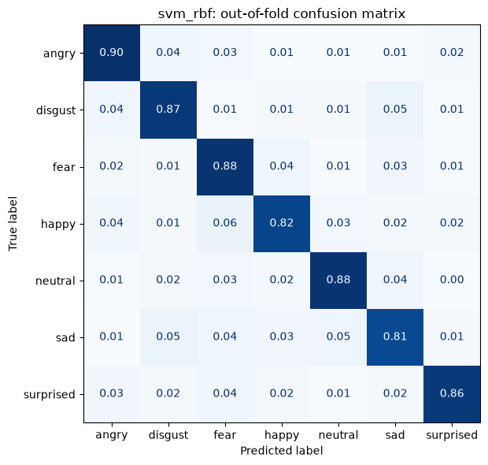

# AudiEmot: Speech Emotion Classification

Recognising emotion from the sound of a voice, using hand-built audio features and classical machine learning.




*The same actor saying the same sentence. Brightness shows energy at each frequency over time (seconds), and the cyan line tracks the pitch of the voice. The angry take is higher pitched, with more energy in the upper frequencies. The blank area is where the shorter clip has ended.*

## The competition

[Audio Speech Emotion Classification](https://www.kaggle.com/competitions/audio-speech-emotion-classification) is a Kaggle course competition. The task is to label 201 short speech clips with one of seven emotions: angry, disgust, fear, happy, neutral, sad or surprised. Entries are scored on mean F1. Training data isn't provided, so models are built from two public datasets:

| Dataset | Clips | Speakers | Spoken text |
|---|---|---|---|
| [RAVDESS](https://zenodo.org/records/1188976) | 1,440 | 24 actors | 2 sentences |
| [TESS](https://www.kaggle.com/datasets/ejlok1/toronto-emotional-speech-set-tess) | 2,800 | 2 actresses | "Say the word ___" with 200 words |

## Results so far

The best single model is an **SVM with an RBF kernel**, at **0.858 macro F1** in cross-validation.



| Model (tuned) | Macro F1 | RAVDESS | TESS |
|---|---|---|---|
| **SVM (RBF)** | **0.858** | **0.538** | 0.995 |
| Logistic regression | 0.836 | 0.500 | 0.981 |
| Random forest | 0.832 | 0.441 | 0.997 |
| k-NN | 0.819 | 0.414 | 0.995 |
| Decision tree | 0.738 | 0.306 | 0.921 |

**RAVDESS is the number to watch.** Its validation folds use actors the model has never heard, while TESS has only two speakers, so they appear in both training and validation. The 0.538 is the better guide to how the model handles a new voice. The headline 0.858 is lifted by TESS, which makes up 69% of the scored clips.

## How it was built



**Phase 0: Setup.** Created the environment and downloaded the data. Both training downloads contained a duplicate copy of the dataset, which checksums confirmed were identical, so only one copy is used.

**Phase 1: Metadata** ([`build_metadata.py`](src/build_metadata.py)). Built one table of all 4,240 training clips from their file and folder names, then mapped both datasets onto the seven competition labels. RAVDESS's extra "calm" emotion has no competition label, so it's excluded from training.

**Phase 2: Exploration** ([notebook](notebooks/02_explore.ipynb)). Listened to clips and measured every file. Two findings shaped everything after:
- The 80 test clips at 16 kHz match RAVDESS on length, silence and background noise, so the test set appears to be about 60% TESS and 40% RAVDESS.
- Silence looked like a sign of neutral speech, but only because most neutral clips come from TESS, whose clips have almost no silence. Anything that identifies the dataset can mislead a model.

**Phase 3: Features** ([`features.py`](src/features.py)). Converted every clip to mono at 16 kHz, trimmed the silence and normalised the loudness. Each clip was then summarised as fixed-length numbers describing tone (MFCCs), brightness, noisiness, loudness over time and pitch.

**Phase 4: Validation** ([`validation.py`](src/validation.py), [notebook](notebooks/04_validation.ipynb)). Built one scoring method for every model. A random split would put the same actor in training and validation and inflate the score, so folds are grouped by actor for RAVDESS and by word for TESS. Tests on the calm clips, recorded loudness and clip length showed no measurable gain, so all three were left out as the simpler and safer choice.

**Phase 5: Classifiers** ([notebook](notebooks/05_classifiers.ipynb)). Compared and tuned five model families, then retrained the best on all the data and made a first [Kaggle submission](submissions/audiemo_phase5_svm_rbf.csv). The main lessons:
- **Scaling matters for models that compare distances.** Without it, the SVM falls from 0.854 to 0.234 and k-NN from 0.803 to 0.527, while the random forest doesn't change.
- **Deeper trees overfit** (below, left). Training score reaches 1.0, but validation score stops improving at around depth 8.
- **Tuning added little.** Only k-NN's gain was larger than the variation between folds, and only just.

| Overfitting in a decision tree | SVM confusion matrix |
|---|---|
|  |  |

The matrix on the right pools both datasets, so TESS's near-perfect scores flatter it. Its largest single confusion is happy mistaken for fear (0.06).

## What's next

Phase 6 combines models into ensembles, which is the competition's stated goal. After that come error analysis and a test on a newly recorded voice. The [roadmap](ROADMAP.md) has the full plan and the detailed findings from each phase.

## Run it yourself

Requires Python 3.15 and a [Kaggle API token](https://www.kaggle.com/settings). Accept the competition rules on Kaggle first, then download the data as below. The test zip already contains a nested folder, which the code expects.

```bash
python3 -m venv .venv && source .venv/bin/activate
pip install -r requirements.txt

mkdir -p data/raw/kaggle_test data/raw/ravdess data/raw/tess
kaggle competitions download -c audio-speech-emotion-classification -p data/raw/kaggle_test
unzip -q data/raw/kaggle_test/*.zip -d data/raw/kaggle_test
kaggle datasets download -d uwrfkaggler/ravdess-emotional-speech-audio -p data/raw/ravdess --unzip
kaggle datasets download -d ejlok1/toronto-emotional-speech-set-tess -p data/raw/tess --unzip

python src/build_metadata.py
python src/features.py
```

Then run the notebooks in [`notebooks/`](notebooks/) in numerical order.

## Data credits

- **RAVDESS:** Livingstone, S. R., & Russo, F. A. (2018). *The Ryerson Audio-Visual Database of Emotional Speech and Song.* PLoS ONE 13(5).
- **TESS:** Dupuis, K., & Pichora-Fuller, M. K. (2010). *Toronto Emotional Speech Set.* University of Toronto.
